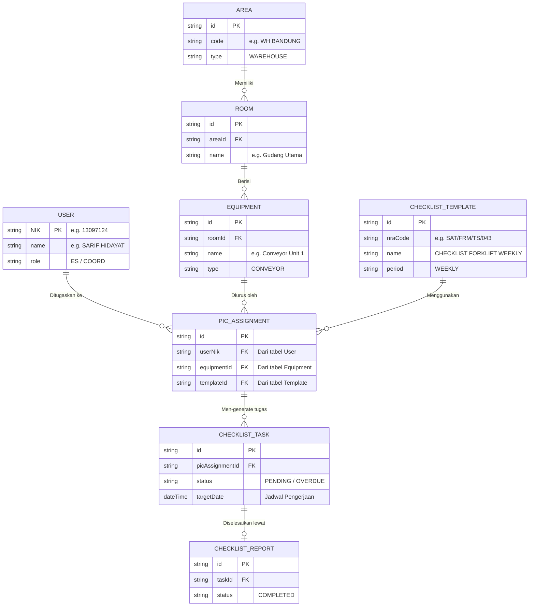

# Proposal Transformasi Sistem Checklist (To-Do List Driven)

## 1. Perbandingan User Journey (As-Is vs To-Be)

Diagram ini menunjukkan bagaimana konsep "To-Do List" akan memangkas proses klik user yang tadinya panjang menjadi sangat efisien dan otomatis.

```mermaid
graph TD
    subgraph Flow_Saat_Ini_AsIs [Flow Saat Ini: Manual & Panjang]
        A1[User Login] --> A2[Klik 'Buat Laporan Baru']
        A2 --> A3[Pilih Area dari Dropdown]
        A3 --> A4[Pilih Ruangan]
        A4 --> A5[Pilih Equipment]
        A5 --> A6[Pilih Form/Template]
        A6 --> A7[Isi Form Parameter Cek]
        A7 --> A8[Submit Laporan]
        
        style A2 fill:#f9d0c4,stroke:#e06666
        style A3 fill:#f9d0c4,stroke:#e06666
        style A4 fill:#f9d0c4,stroke:#e06666
        style A5 fill:#f9d0c4,stroke:#e06666
        style A6 fill:#f9d0c4,stroke:#e06666
    end

    subgraph Flow_Baru_ToBe [Flow Baru: To-Do List]
        B1[User Login] --> B2{Sistem Identifikasi NIK User}
        B2 --> B3[Dashboard Menampilkan <br> Card 'Tugas Anda Hari Ini']
        B3 --> B4[User Klik Task Spesifik <br> e.g., 'Checklist Forklift Weekly']
        B4 -. Bypass (Otomatis deteksi Area/Room/Aset) .-> B7
        B7[Langsung Isi Form Parameter Cek] --> B8[Submit Laporan]
        
        style B3 fill:#d9ead3,stroke:#93c47d
        style B4 fill:#d9ead3,stroke:#93c47d
        style B7 fill:#cfe2f3,stroke:#6fa8dc
    end
```

**Penjelasan untuk Atasan:** 
*"Pak/Bu, perhatikan kotak berwarna merah. Itu adalah *pain points* user saat ini karena harus memilih data berulang kali secara manual. Di Flow Baru (hijau), *pain points* itu sepenuhnya hilang karena sistem yang secara proaktif 'mencarikan' tugas (PR) untuk user tersebut."*

---

## 2. Arsitektur Database (Entity-Relationship Diagram)

Untuk mewujudkan *flow* di atas, data Excel yang Bapak/Ibu berikan (Inventaris, NRA, Data PIC) akan ditransformasi menjadi struktur database relasional sebagai berikut:

### Penjelasan Komponen Baru:
1. **`ROOM` & `EQUIPMENT`**: Tabel baru untuk memecah area menjadi hierarki yang lebih spesifik agar kita tahu pasti barang/mesin mana yang dicek.
2. **`CHECKLIST_TEMPLATE`**: Master tabel form (menyimpan NRA Code).
3. **`PIC_ASSIGNMENT` (Inti Sistem)**: Ini adalah tabel "Penugasan". Menyimpan fakta bahwa *"User A bertugas memeriksa Equipment X menggunakan form Y"*.
4. **`CHECKLIST_TASK`**: Ini adalah tabel **To-Do List**. Sistem (melalui *cron/scheduler* dari kalender excel) akan men-generate baris di tabel ini setiap minggu/bulan. Tabel inilah yang di-*query* dan ditampilkan di Dashboard user saat mereka login.
